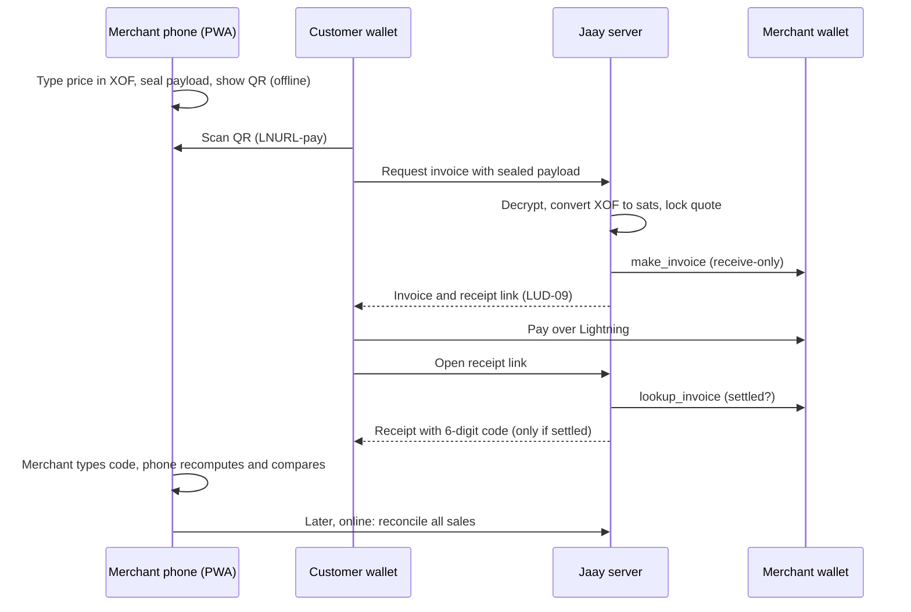
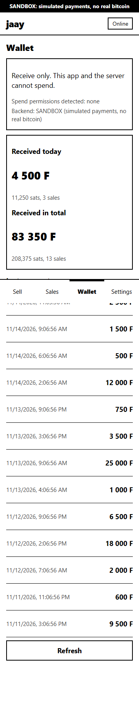
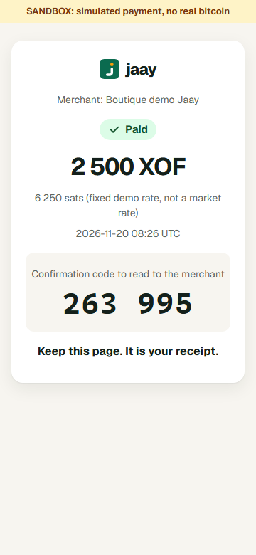
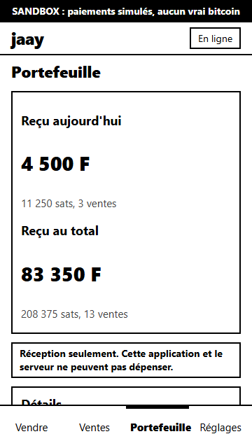

# jaay

**Sell without signal.**
Vendez sans réseau.

[](https://github.com/lijnati/Jaay/actions/workflows/ci.yml)

> **SANDBOX demo: simulated payments, no real bitcoin.** The demo uses a fixed demo rate (40,000,000 XOF per BTC). Real Lightning was only exercised on regtest (spike S1).

Jaay (Wolof for "to sell", spelling to be confirmed by a Wolof speaker) is an open-source point of sale that runs as a PWA on the merchant's own phone and takes Lightning payments with the phone in airplane mode. Built for the Dakar Bitcoin Hack by BTrust.

## The problem

A seller who takes Bitcoin over Lightning normally needs a data connection on the selling phone at the moment of sale, or a dedicated hardware device. Market sellers whose mobile data drops or runs out mid-sale lose the sale. Pricing is a second problem: a price in sats fixed while offline can be stale when the customer pays. [needs real evidence from Nahtty's interviews]

## What Jaay does

1. The merchant types a price in XOF. The phone, even in airplane mode, shows an LNURL-pay QR that carries an AES-256-GCM sealed payload (amount, random sale id, currency; device id as AAD).
2. The customer scans with any LNURL-pay wallet. The server decrypts, converts XOF to sats at scan time (Kraken with Coinbase fallback, 2 percent divergence check, 120 s quote lock, rounded up to a whole sat) and creates the invoice on the merchant's own wallet through a receive-only connection.
3. After payment the wallet shows a receipt link (LUD-09 url success action). The receipt page shows a 6-digit confirm code only once the invoice has settled.
4. The merchant types the code. The phone recomputes it from the sale id with a device-key HMAC and compares. When online, the phone reconciles every sale with the server and flags any sale confirmed without a payment.



## 60-second quickstart

Needs Node 22.13 or newer and pnpm 11 via corepack.

```bash
corepack enable
pnpm install
pnpm demo
```

| URL | What it is |
|---|---|
| http://localhost:8787/app/ | Merchant app |
| http://localhost:8787/sim/ | SANDBOX customer wallet simulator |
| http://localhost:8787/healthz | Health check |

Everything here is SANDBOX: simulated payments, no real bitcoin, fixed demo rate labeled "fixed demo rate" everywhere. `pnpm smoke` checks it. Details and a step by step tour: [docs/QUICKSTART.md](docs/QUICKSTART.md).

## Screenshots

Sandbox data, 360 px wide.

| | Sell | Check code | Wallet | Receipt after payment |
|---|---|---|---|---|
| EN |  |  |  |  |
| FR |  |  |  |  |

## How it works

1. The phone holds non-extractable device keys created at setup.
2. A sale is a random sale id plus an XOF amount, sealed with AES-256-GCM and a random 96-bit IV, device id as AAD.
3. The QR is an LNURL-pay link that carries the sealed payload. It needs no network to draw.
4. The server opens the payload, and any tamper fails closed with one uniform error.
5. The server converts XOF to sats at scan time and creates the invoice on the merchant wallet (NWC NIP-47, LNbits invoice key, or a labeled SANDBOX backend).
6. The receipt page is server-rendered HTML with no JavaScript and shows the code only after settlement.
7. The phone derives the code from the sale id with a device-key HMAC. It is never in the QR and never on the merchant screen.
8. When online, the phone reconciles each sale over the HMAC-signed device API.

Architecture: [docs/ARCHITECTURE.md](docs/ARCHITECTURE.md). Endpoints: [docs/API.md](docs/API.md).

## Security design

Full threat model, 27 threats each naming tests: [docs/THREAT_MODEL.md](docs/THREAT_MODEL.md).

- The sealed QR payload fails closed on any tamper.
- One uniform error for every LNURL failure, so a failing check is never revealed.
- The confirm code appears only after settlement, is never in the payload, and allows 3 attempts per sale (3 in 1,000,000 odds per sale for a guesser). The counter is saved before each check.
- A reconcile backstop flags sales confirmed but never paid.
- The receive-only wallet connection is refused if it can spend.
- The device API is signed with HMAC, uses the server clock and has nonce replay protection.
- Secrets are sealed at rest with AES-256-GCM, and no secrets appear in logs (a log-scrubber test enforces it).
- Strict CSP, no third-party scripts, no CDN, non-extractable keys on the phone.

## Wallet implementation

The wallet side is receive-only. The server creates and looks up invoices only (`make_invoice`, `lookup_invoice`). Enrollment refuses any NWC connection that grants `pay_invoice` or other spend methods, and the server re-checks the live permission list on every Wallet refresh, so the screen warns if spending was granted later. Receive-only is enforced by the wallet service (for example Alby Hub app scopes), not by Jaay or the protocol.

The Wallet screen shows server-computed totals (today and all time, in XOF and sats), the last payments tagged paid, paid late or demo, the badge "Receive only. This app and the server cannot spend.", and a collapsed Details section (spend permissions detected, backend type). There is no send button anywhere.

## Low bandwidth

Measured by the e2e suite:

- PWA first load: 32.4 KB gzipped (budget 150 KB).
- Customer simulator: 10.7 KB gzipped (budget 40 KB).
- Receipt page: under 15 KB with no JavaScript (asserted by a test).
- The POS shell works offline after the first load, including a cold start offline (Playwright test with the browser offline).

Lighthouse and throttled-network measurements: NOT RUN.

## Prior art and what is new

Jaay builds on earlier work and does not claim to be the first offline Lightning point of sale.

- [LNURLPoS](https://github.com/arcbtc/LNURLPoS) by arcbtc is a hardware PoS (ESP32 TTGO T-Display). Its offline device idea: "The burden of connectivity can be taken away from the point-of-sale and given to the phone." Its README lists currency denomination as an issue, "being offline sats becomes too volatile". After payment the customer gets a PIN that the merchant compares with the PIN on the device. Jaay's confirm-code idea comes from this lineage.
- [LNbits TPoS](https://github.com/lnbits/tpos) is "A shareable Bitcoin Lightning Point of Sale that runs directly in your browser." You host an LNbits server and give a TPoS to a vendor, and it can be set to a fiat currency.
- [Blink Terminal](https://www.blink.sv/en/blink-terminal) is "A point of sale that runs in any browser." and works with custodial and non-custodial Blink accounts.
- [Wallet of Satoshi POS](https://www.walletofsatoshi.com/pos) is a POS app for shops, cafes and market stalls.
- [LUD-09](https://github.com/lnurl/luds/blob/luds/09.md) defines the url success action with a description. The url must be on the callback's domain. Jaay uses it for the receipt link.

What is new in Jaay's design: no extra hardware (a PWA on the merchant's existing phone); an XOF price sealed offline and converted to sats by the server at scan time with a quote lock; a settlement-gated receipt with the code; an offline ledger with reconciliation; a receive-only wallet connection; and a written threat model where every row names a test.

## Known limits

- Offline confirmation relies on the code. Reconcile detects fraud after the fact.
- A compromised running server can derive codes and see amounts. It cannot spend from a receive-only wallet.
- A stolen unlocked phone can create sales and confirm within the attempt cap. There is no device revoke button yet.
- There is no app lock or passcode, only the phone OS lock.
- The base URL is not authenticated by the token, so the host is shown under every QR.
- Rate limits are per IP and in memory.
- NOT RUN: Safari, Firefox, real phones, Docker compose, any hosting path.
- Real wallets showing the receipt link were researched (spike S5) but tested only with the simulator.

## Tests and verification

- 127 protocol, 169 server, 146 merchant PWA and 33 simulator unit and property tests, with fast-check property and fuzz tests on a fixed seed.
- Playwright e2e: 14 checks, green at 320, 360 and 412 px wide, including a no-horizontal-scroll check on every screen in EN and FR.
- The threat matrix names 70 tests for 27 threats. `pnpm security:matrix` checks it and `pnpm test:security` runs only the security tests.

```bash
pnpm lint
pnpm typecheck
pnpm test
pnpm build
pnpm --filter @jaay/pos exec playwright install chromium   # once
pnpm --filter @jaay/pos test:e2e
```

Clean-clone results: [docs/VERIFY.md](docs/VERIFY.md). Threat model: [docs/THREAT_MODEL.md](docs/THREAT_MODEL.md). Real Lightning (Alby Hub on regtest LND, receive-only NWC) was exercised in spike S1, see [spikes/NOTES.md](spikes/NOTES.md).

## Roadmap beyond the hackathon

- Pilot with one Bitcoin-accepting merchant in Dakar [needs real evidence from Nahtty's interviews].
- Test real wallets on signet with the receipt link.
- Device revoke and a passcode-wrapped key.
- Wolof strings reviewed by a native speaker.
- Stretch: signed receipt as a Nostr event.

## License and credits

MIT, see [LICENSE](LICENSE). Copyright Yegetaneh Firew. Built for the Dakar Bitcoin Hack by BTrust. French overview: [docs/README.fr.md](docs/README.fr.md). Security reports: [SECURITY.md](SECURITY.md). Contributing: [CONTRIBUTING.md](CONTRIBUTING.md).
