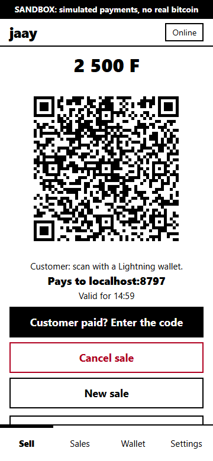
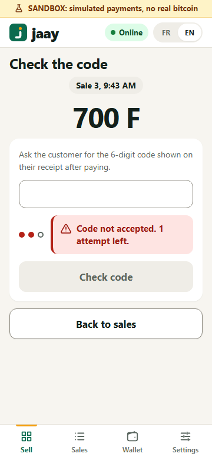
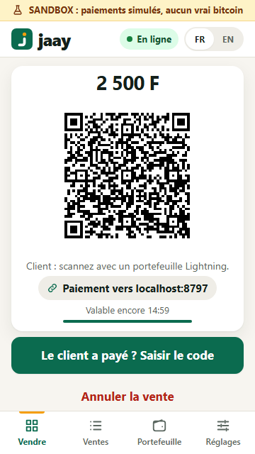
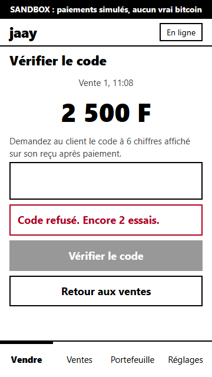
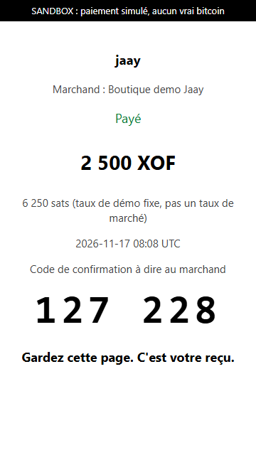
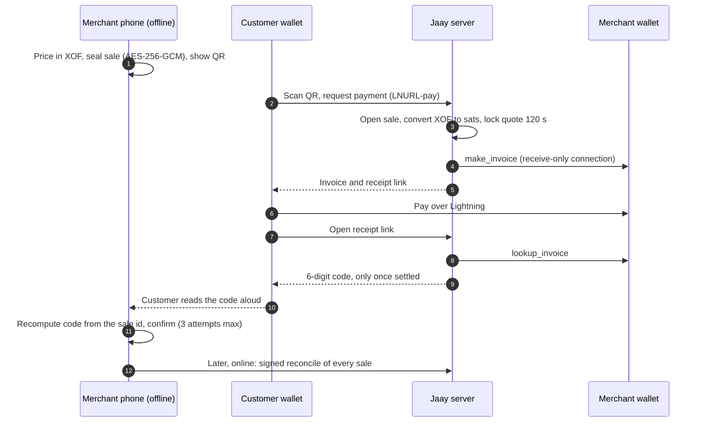

<p align="center">
  
</p>

<h1 align="center">jaay</h1>

<p align="center">
  <strong>Sell without signal.</strong><br>
  <em>Vendez sans réseau.</em>
</p>

<p align="center">
  An open-source Lightning point of sale that keeps working when the merchant's phone is offline.
</p>

<p align="center">
  <a href="https://github.com/lijnati/Jaay/actions/workflows/ci.yml"></a>
  <a href="LICENSE"></a>
  
  
  
</p>

<p align="center">
  <strong><a href="https://jaay-demo-qzku.onrender.com/app/">Live SANDBOX demo</a></strong> ·
  <a href="#quickstart">Quickstart</a> ·
  <a href="#how-it-works">How it works</a> ·
  <a href="#security">Security</a> ·
  <a href="docs/ARCHITECTURE.md">Architecture</a> ·
  <a href="docs/THREAT_MODEL.md">Threat model</a> ·
  <a href="docs/README.fr.md">Français</a>
</p>

> [!IMPORTANT]
> **The demo is SANDBOX only: simulated payments, no real bitcoin, and a fixed demo exchange rate.** Jaay accepts regtest, signet and testnet invoices only and refuses mainnet. Real Lightning was exercised on regtest (Alby Hub on LND, see [spikes/NOTES.md](spikes/NOTES.md)).

---

## Overview

Jaay (Wolof for "to sell") is a point of sale that runs as a progressive web app on the merchant's own phone. The merchant types a price in West African CFA francs (XOF) and shows a QR code; the customer pays from any LNURL-pay Lightning wallet. **The merchant's phone needs no network at the moment of sale.** It confirms the payment with a 6-digit code from the customer's receipt and reconciles every sale with the server when it is back online.

Built for the Dakar Bitcoin Hack by BTrust.

### Highlights

| | |
|---|---|
| **Offline selling** | After the first load, the merchant app sells, shows QR codes and confirms codes in airplane mode. A service worker serves the whole app; sales live in IndexedDB. |
| **XOF pricing, sats at scan time** | The QR carries the XOF amount. The server converts to sats when the customer scans, with a 120 second quote lock, so an offline price never becomes a stale sats price. |
| **Settlement-gated receipt** | The customer's wallet shows a receipt link (LUD-09). The 6-digit confirm code appears on it only after the invoice settles. |
| **Receive-only wallet** | The server can only create and look up invoices on the merchant's wallet (Nostr Wallet Connect or LNbits invoice key). Connections that can spend are refused. There is no send button anywhere. |
| **Reconciliation** | Back online, the phone checks every sale with the server and flags any sale confirmed without a payment. |
| **No extra hardware** | Runs on the phone the merchant already has. 32.4 KB gzipped first load. French first, English toggle. |

## Screenshots

<table>
  <tr>
    <td align="center"><br><sub>Sell</sub></td>
    <td align="center"><br><sub>Check code</sub></td>
    <td align="center"><br><sub>Wallet</sub></td>
    <td align="center"><br><sub>Customer receipt</sub></td>
  </tr>
  <tr>
    <td align="center"><br><sub>Vendre</sub></td>
    <td align="center"><br><sub>Vérifier le code</sub></td>
    <td align="center"><br><sub>Portefeuille</sub></td>
    <td align="center"><br><sub>Reçu</sub></td>
  </tr>
</table>

<sub>SANDBOX data, 360 px wide, captured by the end-to-end test suite.</sub>

## Quickstart

**Requirements:** Node 22.13 or newer, pnpm 11 (through Corepack), git. No Docker, no database server, no internet after install.

```bash
corepack enable
pnpm install
pnpm demo
```

| URL | What it is |
|---|---|
| http://localhost:8787/app/ | Merchant app (installable PWA) |
| http://localhost:8787/sim/ | SANDBOX customer wallet simulator |
| http://localhost:8787/healthz | Health check |

Or try the hosted SANDBOX demo without installing anything: [merchant app](https://jaay-demo-qzku.onrender.com/app/) and [customer simulator](https://jaay-demo-qzku.onrender.com/sim/) (free hosting: the first visit after 15 idle minutes takes a moment to wake up, and the demo data resets on restart).

In the merchant app, tap **Try the sandbox demo shop**, sell 2,500 XOF, open **Demo tools** under the QR and pay from the simulator, then type the code from the receipt. The full guided tour is in [docs/QUICKSTART.md](docs/QUICKSTART.md). Check a running instance with `pnpm smoke`.

## How it works



1. **Sell.** The phone seals the amount, a random sale id and the currency with AES-256-GCM (random 96-bit IV, device id as associated data) and encodes it as an LNURL-pay QR. No network is used.
2. **Price.** The server opens the sale, rejects anything tampered with one uniform error, and converts XOF to sats from two exchange sources (Kraken, Coinbase fallback) with a 2 percent divergence check, rounding up to a whole sat.
3. **Invoice.** The server creates the invoice on the merchant's own wallet and checks it (network, exact amount, payment hash, description hash, expiry) before any wallet sees it.
4. **Receipt.** After payment, the receipt page (server-rendered, no JavaScript, under 15 KB) shows the code. Before settlement it never does.
5. **Confirm.** The phone derives the same code from the sale id with its own key and compares. The code is never in the QR and never displayed to the merchant.
6. **Reconcile.** When online, the phone sends its sales to the server over an HMAC-signed API and flags any mismatch.

## Architecture

```
packages/protocol    Sale token, keys, confirm code, LNURL encoding. Pure TypeScript on Web Crypto; runs in the browser and on Node.
apps/server          Hono on Node 22+. LNURL-pay endpoints, receipts, signed device API, FX, SQLite (node:sqlite).
                     Wallet backends behind one interface: nwc (NIP-47), lnbits (invoice key), sandbox (labeled fake).
apps/pos             Merchant PWA. Vanilla TypeScript and Vite, service worker, IndexedDB ledger, FR and EN.
apps/customer-sim    SANDBOX customer wallet simulator for demos and tests. Clearly labeled, holds no secret.
spikes/              Feasibility spikes (real NWC on regtest, offline PWA, FX, wallet behavior), with notes.
```

The server serves the merchant app at `/app/` and the simulator at `/sim/` from the same origin, under a strict Content Security Policy. Details: [docs/ARCHITECTURE.md](docs/ARCHITECTURE.md). HTTP API: [docs/API.md](docs/API.md).

## Security

Every claim below is backed by named tests. The [threat model](docs/THREAT_MODEL.md) covers 27 threats; `pnpm security:matrix` fails if any test it names is missing, and `pnpm test:security` runs exactly those tests.

- **Tamper-proof sales.** Any change to the QR payload fails closed, with one uniform error that never reveals which check failed.
- **Code gated by settlement.** The confirm code is derived, never stored or carried in the payload, and shown only after the invoice settles.
- **Guessing is capped.** 3 attempts per sale, counter saved before each check: a guesser's odds are 3 in 1,000,000 per sale, and reconciliation flags any unpaid confirmation.
- **Receive-only, enforced at enrollment and re-checked.** Spend-capable wallet connections are refused, and live permissions are re-checked on every Wallet refresh.
- **Signed device API.** HMAC over method, path, body, timestamp and nonce; the server clock decides; replayed nonces are refused.
- **Secrets sealed at rest** with AES-256-GCM under a master key, bound to their row and field; no secret in the database file or in logs (log-scrubber test).
- **Hardened web surface.** Non-extractable keys on the phone, strict CSP, no third-party scripts, no CDN, no analytics.
- **Fuzzed.** Property and fuzz tests (fast-check, fixed seed) on the protocol, every public endpoint and reconciliation.

Report a vulnerability privately: [SECURITY.md](SECURITY.md). Phone-side details: [docs/SECURITY_PWA.md](docs/SECURITY_PWA.md).

## Configuration

The server is configured through environment variables. A commented template is in [apps/server/.env.example](apps/server/.env.example).

| Variable | Purpose |
|---|---|
| `BASE_URL` | Public origin wallets call (https; http only on localhost). |
| `PORT` | Listen port, default 8787. |
| `DB_PATH` | SQLite file; in memory in development, `/data/jaay.sqlite` in production. |
| `JAAY_MASTER_KEY` | 32 random bytes (base64) sealing secrets at rest. Required in production. |
| `JAAY_ENROLL_TOKEN` | Operator bearer token for enrolling real wallets. Required in production unless sandbox-only. |
| `JAAY_NETWORK` | `regtest` (default), `signet` or `testnet`. Mainnet is never accepted. |
| `NWC_ALLOWED_RELAYS`, `LNBITS_ALLOWED_HOSTS` | Anti-SSRF allowlists for wallet connections. |
| `SANDBOX` | `1` enables the labeled fake backend, the demo shop and `/sandbox` routes. |
| `JAAY_FX_FIXED_XOF_PER_BTC` | Fixed demo rate, accepted only with `SANDBOX=1` and labeled everywhere. |
| `JAAY_POS_DIR`, `JAAY_SIM_DIR` | Build folders served at `/app/` and `/sim/`. |
| `TRUST_PROXY` | `1` to read the client IP from `X-Forwarded-For` behind your own proxy. |

The public SANDBOX demo runs on Render from [render.yaml](render.yaml). Deployment notes for Render, Fly.io and Railway: [docs/DEPLOY.md](docs/DEPLOY.md).

## Development

```bash
pnpm lint          # eslint
pnpm typecheck     # tsc in every package
pnpm test          # unit, property and fuzz tests, plus the threat-matrix check
pnpm build         # protocol, server bundle, PWA, simulator
pnpm test:security # only the tests named by the threat model

pnpm --filter @jaay/pos exec playwright install chromium   # once
pnpm --filter @jaay/pos test:e2e                           # Playwright, offline flows included
```

| Suite | Tests |
|---|---|
| Protocol | 127 |
| Server | 169 |
| Merchant app | 146 |
| Customer simulator | 33 |
| End-to-end (Playwright) | 14 checks, green at 320, 360 and 412 px, EN and FR |

A clean clone reaches a green end-to-end run in about five minutes; the measured steps and the determinism checks under full CPU load are in [docs/VERIFY.md](docs/VERIFY.md). Dependencies, licenses and audit results: [docs/DEPENDENCIES.md](docs/DEPENDENCIES.md).

## Performance

| Budget | Measured |
|---|---|
| Merchant app, first load (HTML, JS, CSS, service worker, manifest, icons) | 32.4 KB gzipped (budget 150 KB) |
| Customer simulator | 10.7 KB gzipped (budget 40 KB) |
| Receipt page | 1,360 bytes, no JavaScript (budget 15 KB) |
| Offline | Full app after first load, including a cold start in airplane mode |

Lighthouse and throttled-network timings have not been measured yet.

## Prior art

Jaay builds on earlier Lightning point-of-sale work and does not claim to be the first offline one.

- **[LNURLPoS](https://github.com/arcbtc/LNURLPoS)** by arcbtc: an offline hardware point of sale (ESP32 TTGO T-Display) where the customer receives a PIN after payment that the merchant compares with the device. Its README notes that offline sats pricing "becomes too volatile". Jaay's confirm code comes from this lineage.
- **[LNbits TPoS](https://github.com/lnbits/tpos)**: a shareable browser point of sale on a self-hosted LNbits server, with fiat currency support.
- **[Blink Terminal](https://www.blink.sv/en/blink-terminal)**: a browser point of sale for Blink accounts, custodial or not.
- **[Wallet of Satoshi POS](https://www.walletofsatoshi.com/pos)**: a point-of-sale app for shops and market stalls.

**What Jaay adds:** no dedicated hardware; an XOF price sealed offline and converted at scan time with a quote lock; a receipt that reveals the code only after settlement (LUD-09); an offline ledger with reconciliation; a receive-only wallet connection that is refused if it can spend; and a threat model in which every threat names its tests.

## Known limitations

- Offline confirmation relies on the code. Reconciliation detects a fraud after the phone reconnects; it does not prevent it.
- A compromised running server can derive codes and see amounts. It still cannot spend from a receive-only wallet. Self-hosting is the mitigation.
- Receive-only is enforced by the wallet service (for example Alby Hub app permissions), not by the protocol.
- No device revocation button and no app passcode yet; a stolen unlocked phone can create sales and confirm within the attempt cap.
- Rate limits are per IP and in memory.
- Not yet tested: real phones, Safari and Firefox, real wallets with the receipt link (the simulator is), Docker.

## Roadmap

- Pilot with a Bitcoin-accepting merchant in Dakar.
- Test real wallets on signet with the receipt link.
- Device revocation and a passcode-protected key.
- Wolof interface strings reviewed by native speakers.
- Signed receipts as Nostr events.

Project log and milestones: [docs/ROADMAP.md](docs/ROADMAP.md).

## Contributing

Contributions are welcome. Read [CONTRIBUTING.md](CONTRIBUTING.md) first: no mainnet, no secrets in the repository, tests first for protocol, crypto and authentication code.

## License

[MIT](LICENSE) © 2026 Yegetaneh Firew.
