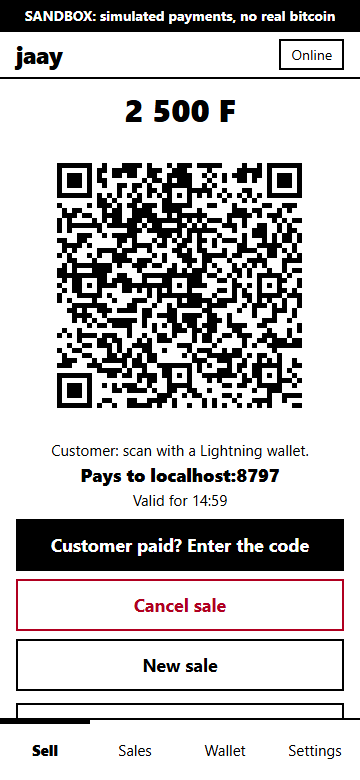
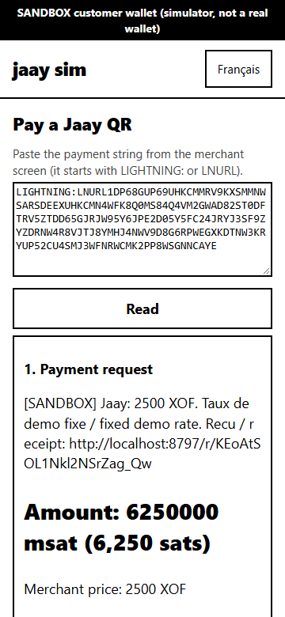
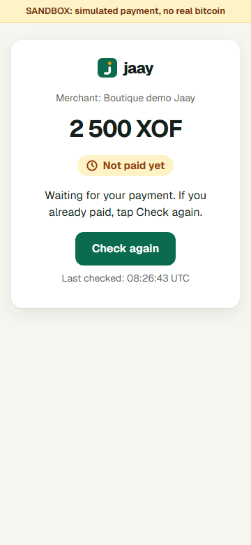
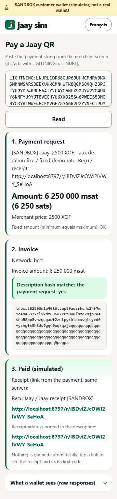
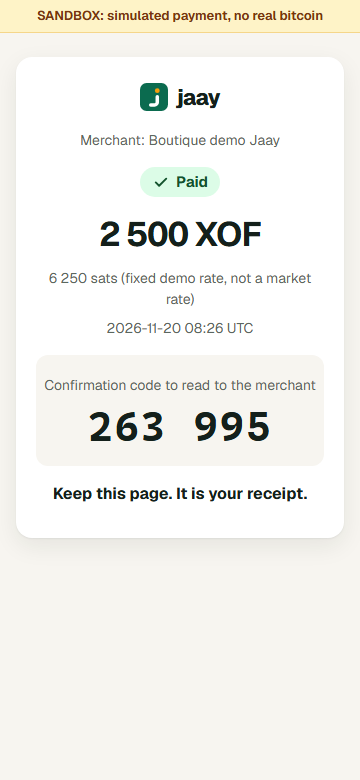
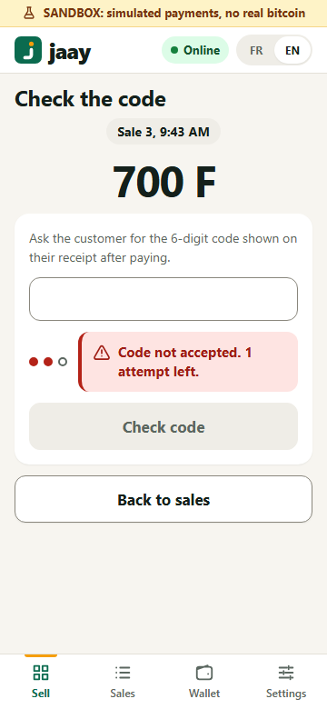
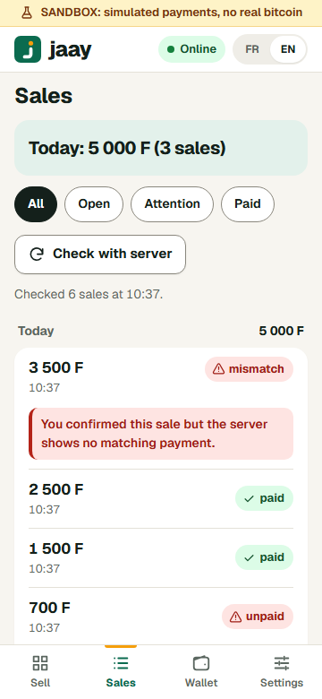
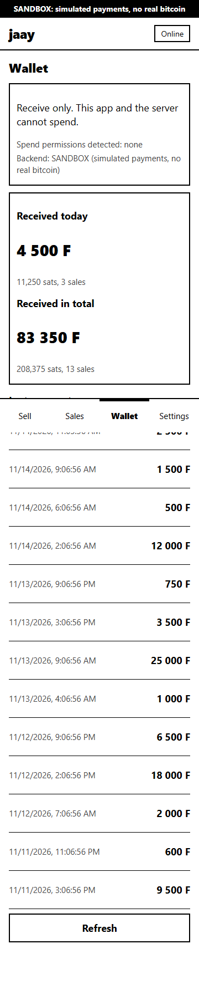

# Quickstart: try Jaay in one command

Everything here is **SANDBOX**: payments are simulated, no real bitcoin moves, and the exchange rate is a **fixed demo rate** (40 000 000 XOF per BTC), not a market rate. Every screen says so.

## Requirements

- Node 22.13 or newer (the server uses the built-in `node:sqlite`). Checked with Node 24.18.
- pnpm 11, through Corepack (`corepack enable` picks the version pinned in `package.json`).
- git. Nothing else: no Docker, no database server, no internet once installed (the demo uses a fixed rate).

## Three commands

```bash
corepack enable
pnpm install
pnpm demo
```

`pnpm demo` builds what is missing, starts the server with `SANDBOX=1` and the fixed demo rate, keeps a generated master key and the SQLite file in `.demo/` (gitignored), and prints:

| URL | What it is |
|---|---|
| http://localhost:8787/app/ | Merchant app (installable PWA, works offline after the first load) |
| http://localhost:8787/sim/ | SANDBOX customer wallet simulator (plays the customer's phone) |
| http://localhost:8787/healthz | Health: `{"status":"ok","fx":"fixed demo rate","sandbox":true}` |

Nothing opens by itself. Stop with Ctrl+C. Check it from another terminal with `pnpm smoke` (prints PASS or FAIL per step). `docker compose up` is meant to do the same, but it has not been run yet (Docker was not available).

## 60-second tour

1. Open the merchant app and tap **Try the sandbox demo shop**. Check the server host shown, tick "This is my server", and set up the device. The device keys are created on the phone and cannot be exported.
2. Type **2500** and tap **Show QR code**. The QR, the amount and the server host appear. In sandbox mode two helpers sit under the QR.

   

3. Open **Demo tools (SANDBOX)** under the sale buttons and tap **Open customer simulator** (or copy the payment string and paste it into /sim/). The simulator shows what a wallet sees: the description, the amount in sats and the XOF price.

   

4. Before paying, the receipt link in the description shows **Not paid yet** and no code.

   

5. Tap **Pay (simulated)**. The simulator checks the invoice (description hash), marks it paid, and shows the receipt link like Phoenix would. It opens nothing itself.

   

6. Tap the receipt link: now it shows the amount, the sats, the time and the **6-digit code**.

   

7. Back in the merchant app, tap **Customer paid? Enter the code** and type the 6 digits. The app checks the code with its own key (3 attempts at most; after a wrong code it says only "Code not accepted" and how many attempts are left) and shows **Payment confirmed**. The code itself never appears on the merchant screen.

   

8. In **Settings**, tap **Load demo data** for a few days of sample sales, then open **Sales** and **Wallet**. The Wallet is receive only: it shows the server's totals and states that the app and the server cannot spend.

    

Try airplane mode too: after the first load, the merchant app keeps selling and confirming codes offline, and checks everything with the server when the network returns.

## Run the checks

```bash
pnpm lint
pnpm typecheck
pnpm test
pnpm build
```

`pnpm test` also checks the threat matrix (`pnpm security:matrix`); `pnpm test:security` runs only the security tests it names.

The browser end-to-end suite needs Chromium for Playwright, installed once:

```bash
pnpm --filter @jaay/pos exec playwright install chromium
```

```bash
pnpm --filter @jaay/pos test:e2e
```

Set `E2E_WIDTH=320` or `E2E_WIDTH=412` to run it at another phone width (default 360). Clean-clone timings: [VERIFY.md](VERIFY.md).

## Next

- Deploy the same build to an HTTPS host and test on real phones: [DEPLOY.md](DEPLOY.md).
- How it works: [ARCHITECTURE.md](ARCHITECTURE.md). Endpoints: [API.md](API.md). PWA security: [SECURITY_PWA.md](SECURITY_PWA.md).
